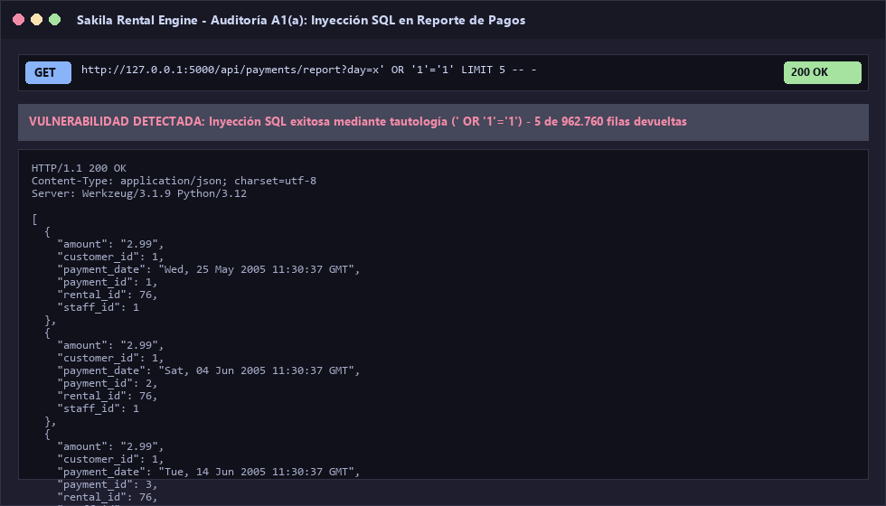
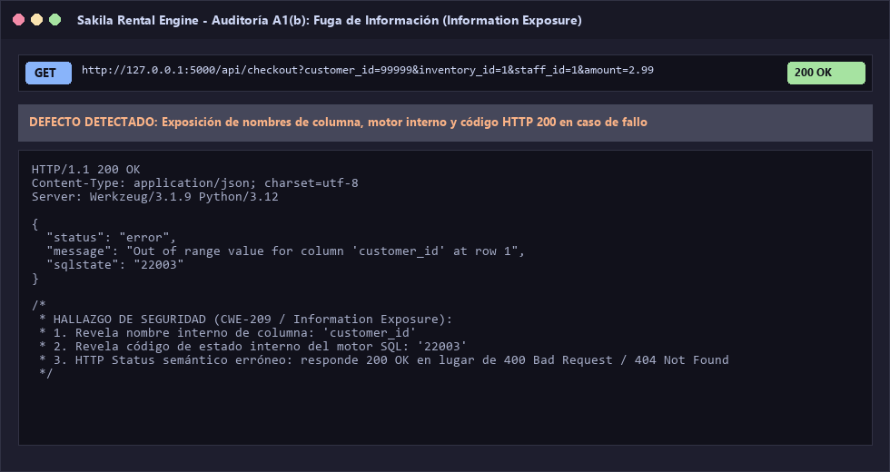
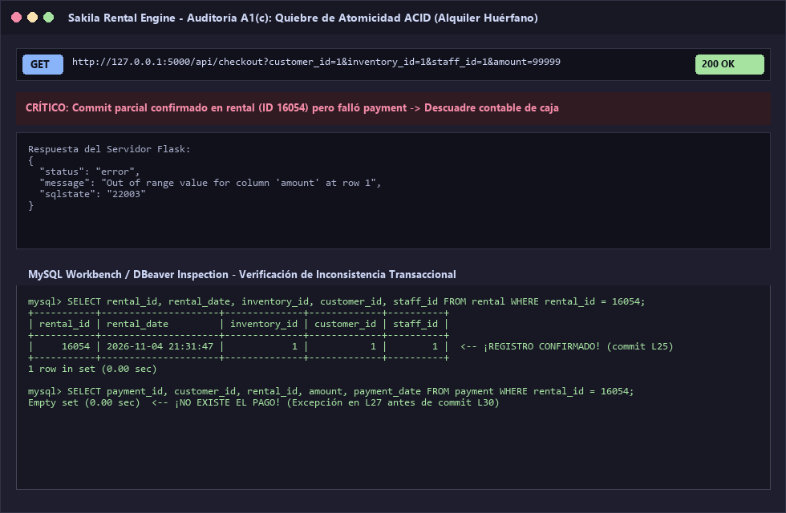
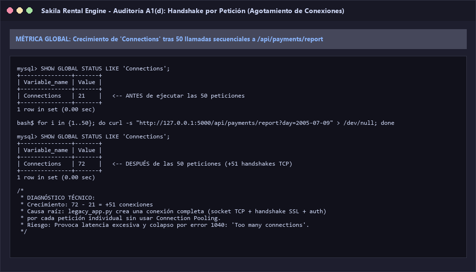

# Parte A: Auditoría del Código Heredado (legacy_app.py)

**Fecha de ejecución:** 4 de noviembre de 2026  
**Entorno de pruebas:** Python 3.12 (Virtualenv), MariaDB 11.4.10, Base de Datos Sakila (~16.046 pagos originales, 962.760 registros en `payment_big`).

---

## A1. Reproducción de Incidentes Empíricos

Los cuatro incidentes fueron reproducidos y registrados mediante el script automatizado `scripts/audit_part_a.py`.

### Incidente (a): Inyección SQL


* **Petición ejecutada:**
  ```http
  GET /api/payments/report?day=x' OR '1'='1' LIMIT 5 -- - HTTP/1.1
  Host: 127.0.0.1:5000
  ```
* **Código de respuesta HTTP:** `200 OK`
* **Cuerpo de la respuesta (muestra JSON):**
  ```json
  [
    {
      "amount": "2.99",
      "customer_id": 1,
      "payment_date": "Wed, 25 May 2005 11:30:37 GMT",
      "payment_id": 1,
      "rental_id": 76,
      "staff_id": 1
    },
    {
      "amount": "2.99",
      "customer_id": 1,
      "payment_date": "Sat, 04 Jun 2005 11:30:37 GMT",
      "payment_id": 2,
      "rental_id": 76,
      "staff_id": 1
    }
  ]
  ```
* **Análisis del defecto:** La concatenación directa de la variable `day` en la consulta `SELECT * FROM payment_big WHERE DATE(payment_date) = '...'` permite inyectar el predicado tautológico `' OR '1'='1'`, anulando el filtro de fecha. Se utilizó `LIMIT 5` para no desbordar la memoria del servidor con el millón de filas almacenadas en `payment_big`.

---

### Incidente (b): Information Exposure (Fuga de Información)


* **Petición ejecutada:**
  ```http
  GET /api/checkout?customer_id=99999&inventory_id=1&staff_id=1&amount=2.99 HTTP/1.1
  Host: 127.0.0.1:5000
  ```
* **Código de respuesta HTTP:** `200 OK` (Código semántico incorrecto ante un fallo de negocio/BD)
* **Cuerpo de la respuesta:**
  ```json
  {
    "status": "error",
    "message": "Out of range value for column 'customer_id' at row 1",
    "sqlstate": "22003"
  }
  ```
* **Análisis del defecto:** La aplicación captura `mysql.connector.Error` y vuelca directamente `err.msg` y `err.sqlstate` en el cuerpo de la respuesta al cliente. Esto expone detalles del esquema relacional (nombres de tablas, columnas y tipos de datos), facilitando ataques dirigidos. Además, responde con código HTTP `200` a pesar de tratarse de un error, violando la semántica REST.

---

### Incidente (c): Alquiler Huérfano (Quiebre de Atomicidad ACID)


* **Petición ejecutada:**
  ```http
  GET /api/checkout?customer_id=1&inventory_id=1&staff_id=1&amount=99999 HTTP/1.1
  Host: 127.0.0.1:5000
  ```
* **Código de respuesta HTTP:** `200 OK`
* **Cuerpo de la respuesta:**
  ```json
  {
    "status": "error",
    "message": "Out of range value for column 'amount' at row 1",
    "sqlstate": "22003"
  }
  ```
* **Estado en la Base de Datos tras el incidente:**
  * **Nuevo registro en `rental`:**
    ```json
    {
      "rental_id": 16054,
      "rental_date": "2026-11-04 21:31:47",
      "inventory_id": 1,
      "customer_id": 1,
      "return_date": null,
      "staff_id": 1
    }
    ```
  * **Nuevo registro en `payment`:** `0 filas` (Ningún registro insertado).
* **Análisis del defecto:** El código realiza un `conn.commit()` prematuro en la línea 25 inmediatamente después de insertar en `rental`. Cuando la línea 27 intenta insertar en `payment` con un monto de `99999` (que desborda el tipo `DECIMAL(5,2)`), el motor lanza un error. La excepción salta al bloque `except`, pero el alquiler ya quedó guardado en la base de datos de manera definitiva. Esto genera un **alquiler huérfano** (película registrada como alquilada y no disponible, pero sin pago registrado en caja).

---

### Incidente (d): Handshake por Petición (Agotamiento de Conexiones)


* **Petición evaluada en bucle (50 veces):**
  ```http
  GET /api/payments/report?day=2005-07-09 HTTP/1.1
  Host: 127.0.0.1:5000
  ```
* **Métrica evaluada en MySQL:** `SHOW GLOBAL STATUS LIKE 'Connections';`
* **Valor antes de las 50 peticiones:** `21`
* **Valor después de las 50 peticiones:** `72`
* **Incremento observado:** `+51 conexiones`
* **Análisis del defecto:** Cada petición HTTP llama a `get_conn()`, abriendo una nueva conexión TCP contra el servidor de base de datos sin utilizar un pool de conexiones reutilizables. Cada llamada incurre en el costo de handshake TCP, intercambio de credenciales y asignación de memoria en el motor. En un entorno de alta concurrencia, este comportamiento satura el límite de `max_connections` y colapsa el servidor.

---

## A2. Matriz de Hallazgos Técnicos (16 Defectos Identificados)

| # | Línea(s) | Defecto detectado | Categoría | Riesgo o impacto | Corrección y concepto teórico |
| :-: | :--- | :--- | :--- | :--- | :--- |
| **1** | 8-9 | Credenciales quemadas en código fuente (`user="root"`, `password="root"`). | **Seguridad** | Exposición de credenciales de máximo privilegio en control de versiones; imposibilidad de configurar por entorno. | Cargar credenciales desde variables de entorno (`.env`) y crear usuario de mínimos privilegios (`sakila_app`). |
| **2** | 8-9, 18, 38, 46 | Conexión sin pool creada por cada petición HTTP (`get_conn()`). | **Red y Escalabilidad** | Sobrecarga extrema de CPU y latencia por handshake TCP/TLS repetitivo; riesgo de error `Too many connections`. | Implementar un Connection Pool singleton (`MySQLConnectionPool`) compartido por proceso con tamaño acotado. |
| **3** | 11 | Endpoint de creación de alquiler expuesto por método HTTP `GET`. | **REST** | Violación del principio de idempotencia y seguridad de `GET` (RFC 7231). Riesgo de alquileres accidentales por prefetching o proxys. | Cambiar a verbo HTTP `POST /api/checkout` con payload JSON en el cuerpo del request. |
| **4** | 13-16 | Parámetros leídos de URL sin tipado ni validación de rangos. | **Seguridad / Calidad** | Excepciones no controladas si se envían valores no numéricos, negativos o IDs inexistentes. | Validación defensiva estricta de esquema, tipos y rangos antes de invocar la capa de datos. |
| **5** | 16, 27-29 | Tarifa de cobro enviada por el cliente (`amount`). | **Seguridad / Lógica de Negocio** | Manipulación de precios del lado del cliente (*Client-side Price Tampering*); clientes pueden pagar $0.01 por cualquier película. | El servidor debe calcular el monto autoritativamente consultando `film.rental_rate` a partir del inventario. |
| **6** | 20 | Inyección SQL por concatenación en `inventory_in_stock`. | **Seguridad** | Ejecución de subconsultas arbitrarias y evasión de la comprobación de stock. | Parametrizar la consulta utilizando marcadores `%s` y tupla de argumentos. |
| **7** | 20-24 | Condición de carrera (TOCTOU) en verificación y reserva de inventario. | **Concurrencia** | Dos clientes leen simultáneamente que la copia está libre y ambos la alquilan (doble entrega física del mismo DVD). | Bloqueo pesimista (`SELECT ... FOR UPDATE`) dentro de una transacción atómica para asegurar exclusión mutua. |
| **8** | 22-24 | Inyección SQL por concatenación de múltiples variables en `INSERT INTO rental`. | **Seguridad** | Manipulación de sentencias DML e inserción de datos maliciosos. | Sustituir concatenación por marcadores de posición parametrizados. |
| **9** | 25, 30 | Doble `commit()` en operaciones dependientes de un mismo flujo. | **ACID (Atomicidad)** | Alquileres huérfanos: si falla el cobro, el alquiler ya fue confirmado irreversiblemente en la BD. | Unificar ambas operaciones bajo una sola transacción: un único `commit()` final y `rollback()` incondicional ante fallos. |
| **10** | 27-29 | Inyección SQL mediante formateo con `f-strings` en `INSERT INTO payment`. | **Seguridad** | Permite inyectar valores manipulados en campos críticos de contabilidad y pagos. | Uso de consultas parametrizadas `%s`. |
| **11** | 33-34 | Fuga de mensajes de error internos (`err.msg`, `err.sqlstate`). | **Seguridad (Information Hiding)** | Provee información estructural del esquema relacional a atacantes externos. | *Information Hiding*: Registrar el error técnico en logs de servidor y devolver un mensaje genérico al cliente. |
| **12** | 31, 34, 42 | Códigos de estado HTTP incoherentes (devuelve `200 OK` en errores). | **REST** | El cliente no puede distinguir programáticamente entre una operación exitosa y un fallo crítico. | Retornar códigos semánticos: `201 Created` en éxito, `400 Bad Request`, `404 Not Found`, `409 Conflict`, `500 Server Error`. |
| **13** | 18-34, 38-42, 46-51 | Fuga de recursos por ausencia de cierre de cursores y conexiones. | **Escalabilidad** | Fuga de descriptores de socket y memoria (*connection leak*), especialmente al ocurrir excepciones. | Uso de context managers (`with`) o bloques `try...finally` para garantizar el cierre y retorno de conexiones al pool. |
| **14** | 36, 40 | Borrado expuesto por `GET` con concatenación e inconsistencia de clave foránea. | **REST / Integridad Referencial** | Borrado accidental por crawling; violación de la restricción de FK en `payment.rental_id`. | Implementar verbo `DELETE`, validar claves foráneas o implementar borrado lógico seguro. |
| **15** | 49-50 | Inyección SQL y consulta no sargable en `DATE(payment_date)`. | **Seguridad / Rendimiento** | Inyección SQL directa. El uso de la función `DATE()` impide el uso de índices, forzando un Full Table Scan de 1M de filas. | Parametrizar con rango sargable (`payment_date >= %s AND payment_date < %s`) y añadir paginación. |
| **16** | 54 | Modo de depuración habilitado en entorno productivo (`debug=True`). | **Seguridad** | Riesgo de ejecución remota de código (RCE) a través de la consola interactiva del debugger de Werkzeug. | Desactivar `debug=False` y controlar por variable de entorno `FLASK_ENV`. |

---

## A3. Los Tres Hallazgos Más Críticos y su Justificación

1. **Inyección SQL Generalizada (Líneas 20, 23, 28, 40, 50):**
   * **Justificación:** Tiene el impacto más severo posible (pérdida total de confidencialidad, integridad y disponibilidad). La probabilidad de explotación es del 100%, ya que no requiere autenticación y los parámetros son directamente accesibles desde el navegador. Permite exfiltrar el catálogo completo de pagos, clientes y usuarios, o alterar los saldos de caja.
2. **Quiebre de Atomicidad Transaccional / Alquileres Huérfanos (Líneas 25 y 30):**
   * **Justificación:** Genera una inconsistencia financiera directa en el negocio. Si la inserción del pago falla (por fallo de red, tarjeta o validación de monto), la película ya quedó registrada como alquilada y descontada del inventario físico sin registrar ningún ingreso monetario. Viola el principio más básico de las transacciones ACID.
3. **Condición de Carrera en la Reserva de Inventario (Líneas 20-24):**
   * **Justificación:** Es un fallo de arquitectura de concurrencia (TOCTOU). En entornos con múltiples sucursales o peticiones concurrentes, la verificación `SELECT inventory_in_stock` no reserva la fila, permitiendo que múltiples clientes alquilen simultáneamente el mismo ejemplar físico de una película, generando sobreventa e incidentes en mostrador.

