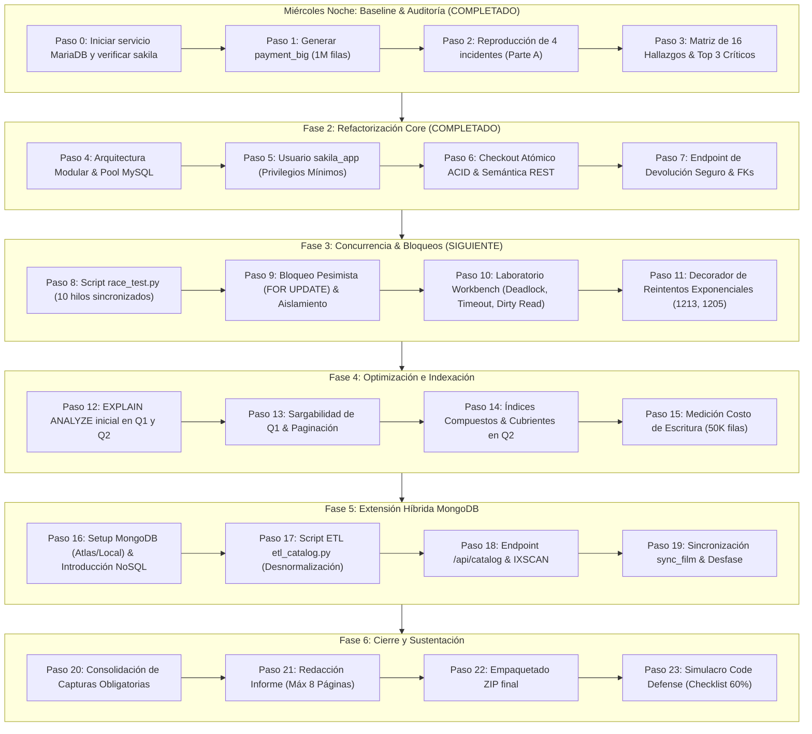

# Hoja de Ruta de Ejecución: Taller Integrador Sakila Rental Engine
**Plazo de Entrega:** Viernes en la tarde (Ventana de ejecución: ~44 horas)  
**Meta de Calificación:** 5.0 / 5.0 (Sustentación 60%, Desarrollo 20%, Evidencias 20%)

---

## 1. Decisiones Técnicas y Estado del Entorno

* **Conector SQL:** `mysql-connector-python` con `mysql.connector.pooling.MySQLConnectionPool` (fácil de defender, transacciones y cursores nativos sin magia de ORM).
* **Motor SQL Local:** **MariaDB 11.4.10** detectado en `C:\mariadb` (puerto 3306, datos en `C:\mariadb\data\sakila`).
* **Motor NoSQL (MongoDB):** Se abordará en la **Parte E (Viernes Mañana)** mediante una guía paso a paso. Usaremos un clúster gratuito en la nube (**MongoDB Atlas**) o MongoDB local con **MongoDB Compass** para visualizar los documentos fácilmente sin requerir experiencia previa.
* **Entorno Python:** Virtualenv `venv` configurado con dependencias instaladas (`Flask`, `mysql-connector-python`, `pymongo`, `requests`, `python-dotenv`).
* **Repositorio Git:** Inicializado con historial limpio en `main` y ramas de características (`feature/*`).

---

## 2. Estrategia y Flujo de Trabajo Git

### 2.1 Estándar de Commits (Conventional Commits)
* `[x] chore(baseline): agregar codigo heredado legacy_app y entorno base`
* `[x] test(audit): reproducir incidentes sqli, info exposure, alquiler huerfano y handshake`
* `[x] docs(audit): matriz de 12 hallazgos y clasificacion de riesgos criticos`
* `[x] refactor(db): pool de conexiones unico, configuracion por entorno y usuario sakila_app`
* `[x] feat(checkout): transaccion acid unica, monto en servidor, rest uniforme y devolucion en lugar de borrado`
* `[x] docs(parte-b): justificacion de decisiones y evidencias reales de la parte b`
* `[ ] test(concurrency): implementar race_test.py y documentar condicion de carrera`
* `[ ] feat(concurrency): bloqueo pesimista select for update y politicas de reintento`
* `[ ] perf(sql): sargabilidad de q1, indices compuestos cubrientes y analisis de explain`
* `[ ] feat(hybrid): script etl_catalog, coleccion films y endpoint /api/catalog`
* `[ ] feat(sync): mecanismo de sincronizacion sync_film y prueba de resiliencia`
* `[ ] docs(delivery): informe final de 8 paginas, evidencias rotuladas y empaquetado zip`

### 2.2 Regla de Oro
> [!CAUTION]
> **Prohibición Absoluta:** Jamás concatenar variables en sentencias SQL (`"SELECT ... " + id` o `f"SELECT ... {id}"`). Una sola concatenación anula la entrega automáticamente. Todas las consultas deben usar tuplas de parámetros (`cur.execute("SELECT ... %s", (param,))`).

---

## 3. Cronograma de Ejecución (48 Horas)

---

## 4. Detalle de Actividades por Fases

### ✅ Fase 1: Entorno, Baseline y Auditoría (COMPLETADA)
* `legacy_app.py` creado, Git inicializado con commit base, `venv` con dependencias listo.
* Tabla `payment_big` poblada con 962.760 filas.
* Reproducidos los 4 incidentes de la Parte A y documentados 16 hallazgos en `docs/auditoria_parte_a.md`.

### ✅ Fase 2: Refactorización Modular, Pool y Seguridad (COMPLETADA)
* Separación en capas: `app/routes/`, `app/services/`, `app/repositories/`, `app/db.py`, `app/errors.py`, `app/validators.py` y `config.py`.
* Implementación de `MySQLConnectionPool` con context manager `get_connection()` para liberación segura.
* Creación de usuario `sakila_app` con permisos mínimos (`sql/01_create_app_user.sql`).
* `POST /api/checkout` con transacción atómica pura: cálculo de tarifa en servidor (`film.rental_rate`), inserción en `rental` y `payment`, un solo `COMMIT` y `ROLLBACK` total ante fallos.
* Respuestas JSON estandarizadas y manejo de errores con logging (`logs/app.log`).
* Reemplazo de borrado físico por `PATCH /api/rentals/<id>/return` preservando trazabilidad de `payment.rental_id`.
* Evidencias reales generadas en `evidencias/parte_b/` y documentación en `docs/parte_b.md`.

### ⏳ Fase 3: Concurrencia y Laboratorio de Bloqueos (PENDIENTE)
* Script `race_test.py` con `threading.Barrier` y 10 hilos simultáneos demostrando la sobreventa de una misma copia.
* Corrección mediante bloqueo pesimista (`SELECT ... FOR UPDATE` en transacción).
* Laboratorio de bloqueos (Error 1205 Lock Wait Timeout, Error 1213 Deadlock cruzado, Lectura sucia con `READ UNCOMMITTED` frente a `REPEATABLE READ`).
* Decorador de reintento acotado (máx. 3 intentos con backoff exponencial) para errores transitorios 1213 y 1205.

### ⏳ Fase 4: Optimización e Indexación sobre `payment_big` (PENDIENTE)
* Análisis de ejecución de Q1 y Q2 mediante `EXPLAIN ANALYZE`.
* Transformación de Q1 en consulta *sargable* (rango de fechas con paginación).
* Creación y benchmarking de índices para Q2: comparación entre alternativas e índice cubriente (*Covering Index*).
* Medición empírica del costo de inserción con 50.000 filas antes y después de indexar.

### ⏳ Fase 5: Extensión Híbrida MongoDB (PENDIENTE)
* Configuración de MongoDB y script ETL `etl_catalog.py` para transformar datos relacionales de Sakila en documentos embebidos (`sakila_catalog.films`).
* Endpoint `GET /api/catalog` con filtros (`category`, `actor`, `max_rate`) y paginación.
* Demostración con `explain("executionStats")` del paso de `COLLSCAN` a `IXSCAN`.
* Prueba de consistencia eventual con `sync_film(film_id)` y verificación de resiliencia con MongoDB apagado.

### ⏳ Fase 6: Cierre, Documentación y Sustentación (PENDIENTE)
* Consolidación de evidencias fotográficas obligatorias.
* Redacción del informe final (máx 8 páginas).
* Empaquetado `Apellido_Nombre_TallerSakila.zip`.

---

## 5. Guía de Preparación para la Sustentación Oral ("Code Defense" - 60%)

| Eje Temático | Pregunta Típica del Docente | Respuesta Clave que Debes Dar |
| :--- | :--- | :--- |
| **1. Conectividad / Pool** | *¿Por qué un pool y no abrir conexiones en cada request? ¿Qué pasa si ocurre una excepción?* | Un pool reutiliza conexiones TCP/MySQL eliminando el costo de handshake y autenticación en cada request. Se implementa en un módulo compartido único por proceso y se asegura el retorno al pool mediante bloques `finally` o context managers, evitando fugas de conexiones (*connection leaks*). |
| **2. Transacciones ACID** | *Explícame cómo se cumple cada letra de ACID en tu checkout.* | **A (Atomicidad):** `rental` y `payment` se ejecutan juntos; ante error se hace `ROLLBACK` total. **C (Consistencia):** Se respetan claves foráneas y el saldo de caja no se descuadra. **I (Aislamiento):** InnoDB aísla la transacción según su isolation level mediante MVCC y bloqueos. **D (Durabilidad):** Al hacer `COMMIT`, los cambios quedan garantizados en el redo log de InnoDB. |
| **3. Control de Concurrencia** | *¿Por qué la transacción no bastaba para evitar que se alquilara la misma película dos veces?* | Porque dos transacciones en `REPEATABLE READ` ejecutan lecturas no bloqueantes consistentes (MVCC Snapshot Read) y ambas ven la copia disponible antes de que la otra confirme. Se resolvió con bloqueo pesimista (`SELECT ... FOR UPDATE`), forzando que la segunda espere o rechace la operación. |
| **4. API REST & Seguridad** | *¿Por qué no usamos GET para checkout y qué es Information Hiding?* | GET debe ser idempotente y seguro (no alterar estado del servidor). El checkout cambia el estado y crea recursos, por lo que debe ser POST con body JSON. Information Hiding evita exponer la estructura de tablas o errores nativos de MySQL al cliente, ocultándolos tras mensajes genéricos y registrando el error detallado en los logs internos. |
| **5. Optimización / Sargabilidad** | *¿Por qué `DATE(payment_date)` no usa el índice y qué es un índice cubriente?* | Aplicar una función sobre la columna indexada la vuelve *no sargable* porque el motor debe evaluar la función fila por fila (Full Table Scan). Un índice cubriente (*covering index*) contiene todas las columnas requeridas en el `SELECT`, `WHERE` y `GROUP BY`, permitiendo resolver la consulta leyendo únicamente el árbol B-Tree del índice sin tocar las páginas de datos de la tabla. |
| **6. Arquitectura Híbrida** | *¿Por qué no mover `rental` y `payment` a MongoDB?* | Porque los alquileres y pagos requieren garantías transaccionales estrictas (ACID multi-documento/multi-tabla), integridad referencial estricta y consistencia inmediata. MongoDB es ideal para lecturas masivas y búsquedas de catálogo (desnormalización), mientras MySQL actúa como la única fuente de verdad transaccional. |

